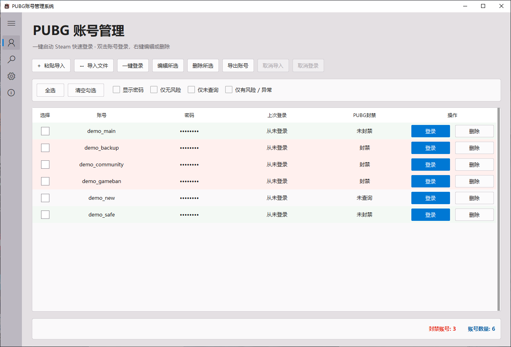
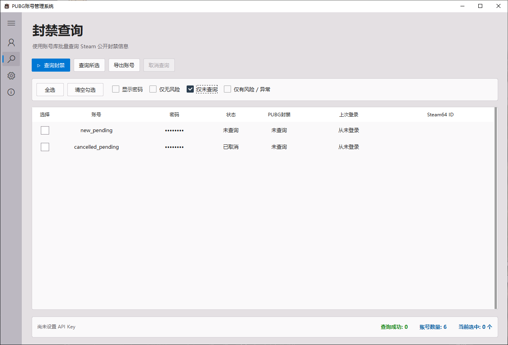

# PUBG账号管理系统

[](https://github.com/Miao9201/PUBG-Account-Manager/releases/tag/v5.0.0)
[](https://github.com/Miao9201/PUBG-Account-Manager/releases/latest)
[](LICENSE)

用于个人 Steam / PUBG 账号管理的 Windows 桌面工具，支持账号导入导出、Steam 自动登录、公开封禁信息查询与结果筛选。采用侧栏导航，提供账号管理、封禁查询、设置和关于四个页面。

**[下载 v5.0.0 Windows EXE](https://github.com/Miao9201/PUBG-Account-Manager/releases/download/v5.0.0/PUBG-Account-Manager-v5.0.0-Windows-x64.exe)** · **[全部版本](https://github.com/Miao9201/PUBG-Account-Manager/releases)** · **[提交问题](https://github.com/Miao9201/PUBG-Account-Manager/issues)**



截图均使用虚构账号和模拟结果，不包含真实账号资料。

## 功能

- **账号导入导出**：支持 CSV、JSON、TXT 文件和粘贴导入；纯文本使用 `账号----密码` 格式。支持编辑、删除与 CSV / JSON / TXT 导出。
- **Steam 登录**：选中账号后一键登录，也可以双击账号或点击行内“登录”。切换账号会关闭当前 Steam 会话，请先结束游戏。
- **封禁查询**：使用自己的 Steam Web API Key，按首次导入顺序逐行查询；需要时使用账号密码解析 Steam64 ID。每行显示未查询、正在查询、查询成功、查询失败或已取消，成功后显示 Steam64 ID。
- **查询范围**：“查询封禁”优先查询复选框勾选的账号，其次查询鼠标高亮的单行；未选择时查询全部。“查询所选”只查询选中的账号。
- **筛选**：“仅无风险”“仅未查询”“仅有风险 / 异常”互斥。“仅未查询”包含已取消且尚无查询结果的账号；失败记录归入风险 / 异常，不当作无风险。
- **进度与取消**：实时更新完成进度和成功数量，取消后保留已完成结果；临时网络故障和短期限流有限重试，全局接口故障保留历史结果。
- **账号清理**：可选择开启“自动删除错误密码账号”，默认关闭；仅在 Steam 明确返回密码错误码 `EResult 5` 且账号密码未被修改时删除。网络错误、验证码、限流和取消不会触发删除。
- **本地保存**：沿用固定数据目录，升级 EXE 不需要重新导入；默认隐藏密码，支持主动显示。

### “PUBG封禁”的含义

本工具**不检测 VAC**。“PUBG封禁”列将 Steam 返回的游戏封禁、社区封禁或库存／经济限制任一命中统一显示为“封禁”。这是本工具的汇总显示，**不等同于确认 PUBG 游戏本身被封禁**：公开接口的游戏封禁计数不指明具体游戏。查询成功且这些字段均无异常时显示“未封禁”；“未查询”、失败或不完整响应不会当作无风险。

## 下载与安装

1. 从 [v5.0.0 Release](https://github.com/Miao9201/PUBG-Account-Manager/releases/tag/v5.0.0) 下载 `PUBG-Account-Manager-v5.0.0-Windows-x64.exe`。
2. 将 EXE 放到你希望的位置，双击运行。无需另外安装 Python。
3. 自动登录需要本机已安装 Steam；联网查询需要有效的 Steam Web API Key。

已验证环境为 **Windows 10 x64、Python 3.14.3**；其他系统版本尚未实测。EXE 未签名，Windows 可能显示发布者提示；请核对下载来源和校验值。

下载 [SHA256SUMS.txt](https://github.com/Miao9201/PUBG-Account-Manager/releases/download/v5.0.0/SHA256SUMS.txt)，在 PowerShell 中核对：

```powershell
Get-FileHash .\PUBG-Account-Manager-v5.0.0-Windows-x64.exe -Algorithm SHA256
```

本次正式发布的 EXE 与维护者当前桌面版本逐字节相同。其内显示版本为 `5.0`，对应发布标签 `v5.0.0`。

## 使用方法

1. **导入账号**：在“PUBG 账号管理”点击“粘贴导入”或“导入文件”。例如使用下列虚构数据：

   ```text
   demo_account_1----demo_password_1
   demo_account_2----demo_password_2
   ```

2. **登录**：勾选或高亮一个账号，点击“一键登录”。Steam Guard、验证码或其他验证要求仍须依照 Steam 实际提示处理，程序不绕过这些验证。
3. **配置查询**：在设置中填入自己的 [Steam Web API Key](https://steamcommunity.com/dev/apikey)，点击“保存 Key”。自动登录不需要 Web API Key。
4. **查询**：切换至“封禁查询”，勾选要查询的账号后点击“查询封禁”。未选中账号时查询全库；只查询筛选结果时，先筛选，再点“全选”，最后查询。
5. **查看与导出**：查看每行状态、封禁汇总和 Steam64 ID。导出优先使用勾选 / 高亮账号；未选择时，可在导出对话框选择当前筛选结果。



## 数据与隐私

数据默认保存于 `%LOCALAPPDATA%\PUBG-Auto-Login\`，目录名称为兼容旧版而保留。

- **账号密码以明文保存在本机 SQLite 数据库**，显示时的圆点遮挡不是加密。导出文件同样可能包含密码，请勿上传账号库、截图或导出文件。
- Steam Web API Key 使用 Windows DPAPI 加密保存，通常只可由原 Windows 用户在原机器解密。
- 登录、Steam64 ID 解析和封禁查询会向 Steam 服务发送所需的账号凭据或 API Key；项目不配置维护者的数据接收服务。
- 源码、测试数据及示例截图不包含使用者真实账号、密码或 API Key。测试使用临时数据库和模拟网络响应。
- 升级前建议备份数据目录；备份同样应按敏感资料保存。开启自动删除功能前请确认备份。

## 从源码运行

需要 Windows x64、Git 和 **Python 3.14**（安装时包含 Tcl/Tk 与 Python Launcher）。

```powershell
git clone https://github.com/Miao9201/PUBG-Account-Manager.git
cd PUBG-Account-Manager
py -3.14 -m venv .venv
.\.venv\Scripts\python.exe -m pip install -r requirements.txt
.\.venv\Scripts\python.exe steam_ban_manager.py
```

完成环境安装后，也可以双击 `运行源码.cmd`。依赖版本固定在 `requirements.txt`，打包工具版本固定在 `requirements-dev.txt`。

## 构建 EXE

```powershell
.\.venv\Scripts\python.exe -m pip install -r requirements-dev.txt
.\.venv\Scripts\python.exe -m unittest discover -s tests -v
.\.venv\Scripts\python.exe steam_ban_manager.py --self-test
.\.venv\Scripts\python.exe -m PyInstaller --noconfirm --clean --onefile --windowed --icon assets/app.ico --add-data "assets;assets" --version-file version_info.txt --name "PUBG账号管理系统" steam_ban_manager.py
```

输出为 `dist\PUBG账号管理系统.exe`；双击 `编译成exe.cmd` 可执行同一套依赖安装、检查和构建步骤。验证打包后的内置自检：

```powershell
$check = Start-Process .\dist\PUBG账号管理系统.exe -ArgumentList '--self-test' -Wait -PassThru
$check.ExitCode  # 0 表示通过
```

三个 Python 模块及 `assets`、`version_info.txt` 必须同时保留。PyInstaller 构建含时间、路径和环境信息，重新构建的 EXE 哈希无需与 Release 二进制相同。

## 仓库结构

```text
steam_ban_manager.py     主程序、账号库、查询与任务状态
steam_login.py           Steam 客户端控制及账号解析
desktop_ui.py            桌面界面与表格布局
assets/                  图标原图与多尺寸 ICO
tests/                   回归测试（临时数据和模拟接口）
docs/images/             虚构数据界面截图
licenses/                依赖许可证原文
requirements.txt         运行依赖
requirements-dev.txt     构建依赖
version_info.txt         Windows 文件版本资源
运行源码.cmd             启动源码
编译成exe.cmd            检查并构建 EXE
自检.cmd                 运行测试与内置自检
LICENSE                  MIT 源码许可证
THIRD_PARTY_NOTICES.md    上游与第三方素材说明
CHANGELOG.md              版本说明
```

构建输出、虚拟环境、缓存、备份、账号库、Key 文件和本机安装记录均不提交到仓库；EXE 单独放在 Releases。

## 来源与许可证

本项目基于 [spdw666/PUBG-Auto-Login](https://github.com/spdw666/PUBG-Auto-Login) 的 `v4.1.2` / 提交 `b69823c962bfd3391a068e1313cf2890f6c4996d`，在其基础上调整界面、查询流程与数据处理。感谢原项目作者。

项目源码以 [MIT License](LICENSE) 发布。图标、依赖及相关商标不因源码使用 MIT 而自动转为 MIT，详见 [第三方说明](THIRD_PARTY_NOTICES.md)。Steam、PUBG 及角色图标的相关权利属于各自权利人，本项目与其官方无隶属关系。

### 已知限制与反馈

- 本次开源发布保留现有 EXE，内置“检查更新”仍指向上游仓库；请使用本仓库的 [Releases](https://github.com/Miao9201/PUBG-Account-Manager/releases) 获取此改版更新。
- 已通过本地回归测试、源码自检、独立环境构建和打包自检；没有使用真实账号凭据进行本次发布的联网验收。
- 提交 Issue 时请提供系统版本、复现步骤和脱敏截图，勿提供账号密码、API Key 或数据库。
